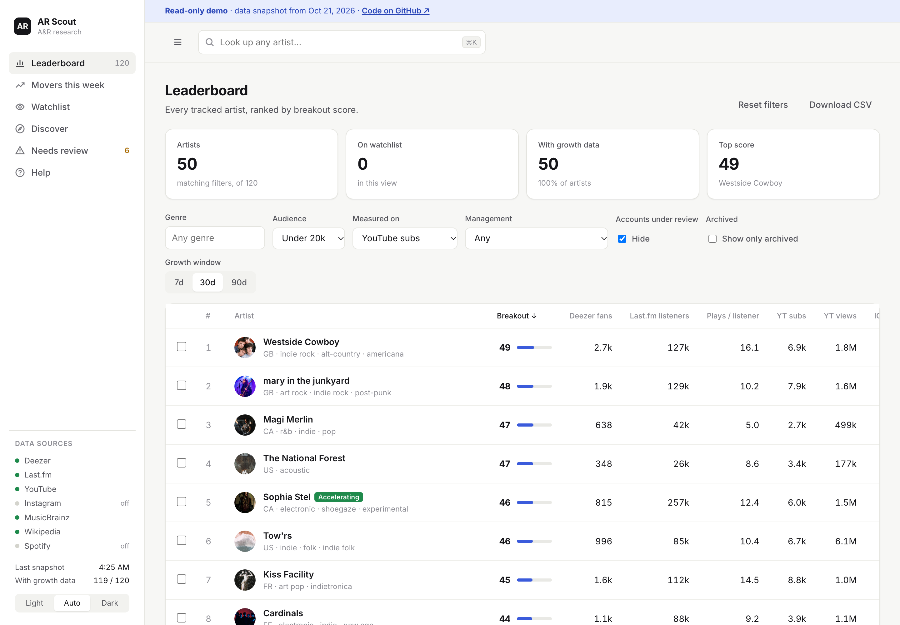
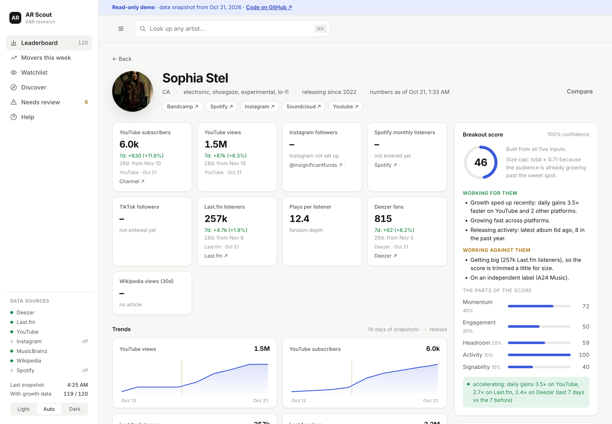
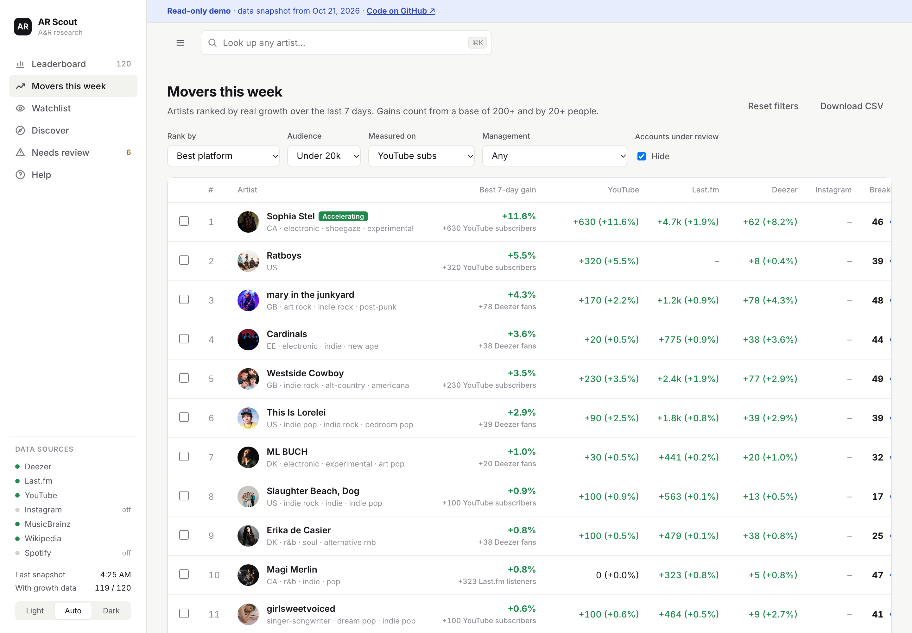
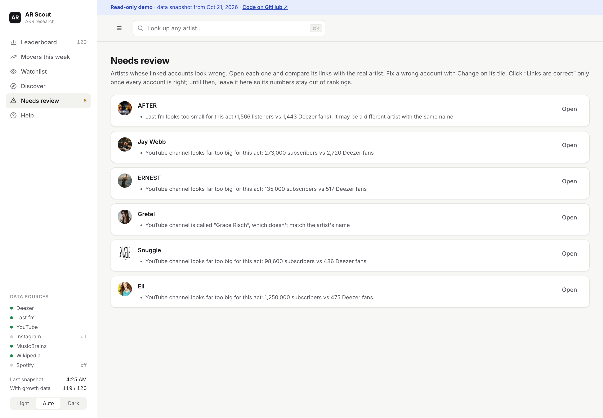

# AR Scout

**An A&R research tool that tracks emerging artists every day across free music data sources and flags who is
breaking out.** Built during an internship at an artist management company to answer one weekly question:
*who's rising, unsigned and unmanaged, and worth a call this week?*

**[Try the read-only demo →](https://carsontolar-del.github.io/AR-Scout/)** · a snapshot of ~120 real artists;
nothing to install.



## What it found

In its second week of tracking, AR Scout flagged **Sophia Stel** as the only one of 134 artists whose growth was
accelerating: after her Oct 16, 2026 album, her daily gains ran **3.6× faster on YouTube, 2.9× on Last.fm and
2.3× on Deezer** than the week before. Release dates are drawn on every chart, so the cause is visible at a glance.



## What it does

- **Daily snapshots** of Deezer fans, Last.fm listeners and plays, YouTube subscribers and views, Instagram
  followers (Graph API Business Discovery), Wikipedia pageviews, and hand-entered Spotify and TikTok numbers.
- **A breakout score (0–100)**: momentum 40%, fandom depth 20%, room to grow 20%, release activity 10%, signs of
  being unsigned 10%, reduced for acts that are already big. Every artist page explains its score in plain words.
- **Signals beside the score**: *Accelerating* (growth speeding up on two or more platforms), real 7- and 28-day
  changes, label type (major / independent / self-released / DIY), and management status read from bios.
- **Movers this week**, a **pipeline board** (watching → contacted → meeting → signed / passed) with owners and due
  dates, **side-by-side comparison**, CSV export and a help page.
- **Discovery** by similar artists, scene tags, curated playlists, new releases and country charts.
- **Three front ends over one core**: a web dashboard, a CLI, and an MCP server so Claude can do the research in
  conversation ("find artists like Fcukers with under 20k YouTube subscribers and tell me who's unsigned").



## Keeping the numbers honest

Free sources match artists by name, and names collide. Most of the engineering went into catching that:

- **A review queue** flags accounts that probably belong to someone else: a YouTube channel far too big or small
  for the act, a channel named for another person, Last.fm numbers that don't fit, a count that jumps overnight.
  Flagged platforms are **left out of the score** until a person fixes or verifies them.
- **Every link can be corrected by hand** (YouTube, Instagram, Last.fm, Deezer), and corrections stick.
  Switching an account deletes the old account's history, so a fix never shows up as growth.
- **Real bugs it caught**: Last.fm's autocorrect had turned *Ratboys* (201k listeners) into *Ratboy* (2.8k); a
  community-edited MusicBrainz link pointed *Of The Trees* at a stranger's empty channel. Both are fixed and covered by tests.
- **Growth needs a week of history.** Projecting a single day's change produced rates like +2,812%/month, so short
  spans don't count.



## How it's built

```
sources/       one module per API: deezer, lastfm, youtube, instagram, musicbrainz, wikipedia, spotify
service.py     link identities, take snapshots, score, discover, review
scoring.py     the breakout score, growth, acceleration (pure functions)
web/           FastAPI app + a single-page dashboard; optional team/admin sign-in
cli.py         Typer CLI          mcp_server.py   MCP tools for Claude
scheduler.py   daily snapshot + backup inside the app when hosted
```

Python 3.12, FastAPI, SQLite, httpx, Typer, vanilla JS. Scores are cached until the data changes (a version
counter bumped by SQLite triggers, so it's correct across processes). **78 tests**, all run against throwaway
data. The dashboard works on phones and in dark mode.

Designed and directed by Carson Wilkinson; built with [Claude Code](https://claude.com/claude-code).

## Run it yourself

```bash
uv sync
cp .env.example .env   # then add free keys (Last.fm, YouTube; Spotify and Instagram optional)
uv run ar-scout status
uv run ar-scout serve  # http://127.0.0.1:8787
```

Works with zero keys (Deezer + MusicBrainz + Wikipedia); Last.fm unlocks tag/country discovery and engagement
scoring, and YouTube adds subscriber/view tracking. Momentum comes from comparing snapshots over time, so take one
daily: `./scripts/install-daily-snapshot.sh` (macOS launchd, 09:00).

| Discovery command | Source | Finds |
|---|---|---|
| `discover similar A B` | Deezer related + Last.fm similar | smaller artists near your references; overlap across seeds ranks first |
| `discover tag "uk drill"` | Last.fm tag charts (deep pages) | emerging acts in a scene |
| `discover playlists "new rap"` | Deezer playlist search | artists getting curator support |
| `discover new --genre "Rap/Hip Hop"` | Deezer editorial + new-music playlists | fresh releases |
| `discover country "Nigeria"` | Last.fm geo charts | regional risers |

### Hosting for a team (Render)

`render.yaml` describes the whole service: a Starter web service with a 1 GB disk for the database, the daily
snapshot at 09:00 inside the app, and the secrets Render will ask for (API keys, team and admin passwords).

1. In Render choose **New → Blueprint** and pick this repo; fill in the values it asks for (long passphrases).
2. When it's live, copy your laptop's history to it: `uv run ar-scout upload-db https://<your-service>.onrender.com`
3. Turn off the laptop's daily job: `launchctl unload ~/Library/LaunchAgents/com.ar-scout.snapshot.plist`

The team password allows everything for scouting; the admin password also allows bulk refresh, relinking,
changing linked accounts, uploads and deleting artists.

### The demo

`uv run ar-scout export-demo --repo <this repo's URL>` writes a static, read-only copy into `docs/` for GitHub
Pages. It leaves out the team's own work: watchlisted artists, notes, pipeline fields and hand-set management.

## Limits worth knowing

- Spotify Dev Mode apps no longer receive followers or popularity (Feb 2026), and there's no free TikTok API, so
  those numbers are typed in from public profiles. Instagram only covers public professional accounts.
- Free sources undercount mainstream US acts, so a missing number can hide a big artist.
- For playlist reach and streaming data at scale you'd need a paid API (Chartmetric, Soundcharts, Songstats);
  `sources/` is built so one can drop in as another module.
- The score is a scouting filter for who to listen to, not a prediction of who will make it.
